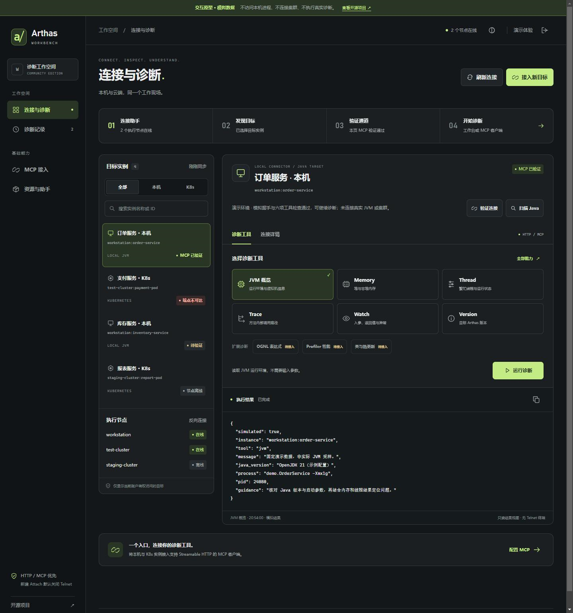
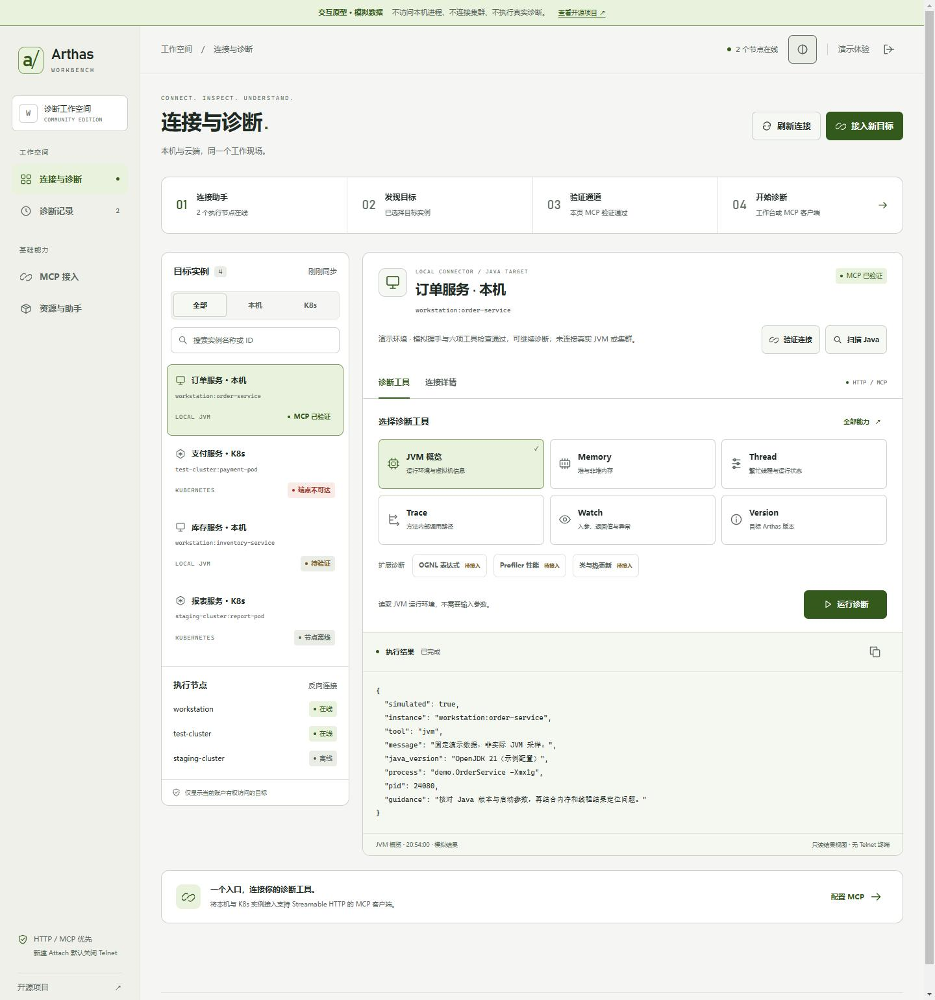
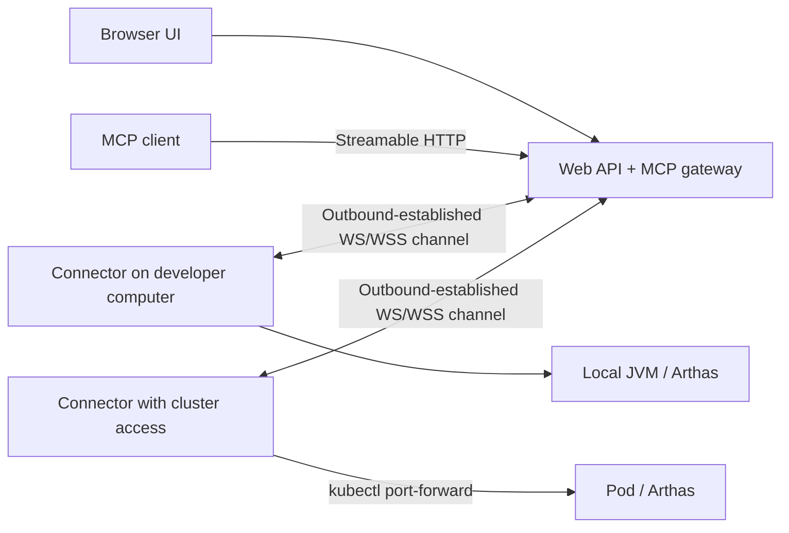

# Arthas Workbench

[](https://github.com/yy568821795-max/arthas-workbench/actions/workflows/ci.yml)
[](LICENSE)


**A shared Web workbench and one MCP endpoint for local and Kubernetes Java diagnostics.**

[中文说明](#中文说明) · [UI preview](https://yy568821795-max.github.io/arthas-workbench/preview/) · [Screenshots](#interface-preview) · [Development](CONTRIBUTING.md) · [Security](SECURITY.md)

> **Prototype — review before deployment.** This repository proves the local/Kubernetes connection paths with an actual Rust connector and simulated upstreams. It is not a production-ready release. There is no one-click installer yet. The public UI preview is entirely simulated and cannot inspect your computer or connect to a cluster.

## Interface preview

[Open the interactive prototype →](https://yy568821795-max.github.io/arthas-workbench/preview/)

Explore the redesigned connections workspace, session history, MCP client setup, and resource/connector roadmap. Search local/Kubernetes targets, verify MCP capabilities, scan and confirm Attach, run diagnostic forms, cancel tasks, and switch themes. The layout also works on phones. All data and actions in the static preview are simulated. You can open `docs/preview/index.html` directly after cloning; no runtime or credentials are needed.

The UI distinguishes an endpoint being reachable from an explicit MCP verification. It offers no interactive Telnet terminal; new local Attach defaults to `telnetPort=-1`. OGNL, Profiler, hot update and automated resource delivery are visible but clearly marked as not yet implemented. See [interface behavior and design](docs/UI.md).

### Dark



### Light



[View the mobile diagnostic screen](docs/images/prototype-mobile.png)

[Send UI feedback](https://github.com/yy568821795-max/arthas-workbench/issues/new?template=ui-feedback.yml). Please include the theme, viewport and steps; remove credentials and private target names from screenshots.

## What works today

| Capability | Prototype status |
| --- | --- |
| Web workspace | Responsive dark/light workspace, target search/filters, MCP verification, diagnostic forms, cancellation, session history, MCP setup templates |
| Local Java | Outbound connector, loopback Arthas forwarding, `jps` discovery, optional explicit Attach |
| Kubernetes | Configured kubeconfig/namespace/Pod → owned `kubectl port-forward` → existing Arthas |
| MCP endpoint | Streamable HTTP at `/mcp`; per-request authentication and explicit instance selection |
| Tools | `list_instances`, `jvm`, `memory`, `version`, `thread`, `trace`, `watch` |
| Isolation | Separate user/node credentials, node access rules, user-scoped upstream sessions, shared per-target concurrency |
| Resilience | Bounded streaming, backpressure, cancellation, reconnect and owned child-process cleanup |

Kubernetes targets currently require an already-running Arthas MCP endpoint. Long trace/watch calls require the target to advertise task support. A successful TCP/HTTP probe alone does not prove that a JVM was correctly attached.

Not implemented: Kubernetes resource upload/Attach, Perl file transfer, hot swap, MySQL, SSO, automatic device pairing, a bundled launcher, full legacy tool compatibility or production audit storage. No OBS integration is included.

## Why a local connector exists

A web page cannot enumerate OS processes or attach to a JVM on its own. The small native connector runs on the target computer, performs these operations within that user's permissions, and initiates a connection to the workbench. Your browser stays the UI.



**Proposed end-user experience:** download once → launch → browser opens → local JVMs appear → select a process. Team sharing becomes an optional sign-in/pairing step. This launcher flow is a design direction, **not an implemented installer**. See [the onboarding design](docs/ONBOARDING.md) for the distinction between personal mode and a shared team server.

## Developer quick start

The current runtime is validated on Windows with Python 3.13. Python 3.11–3.13 is supported by the package constraints. Rust CI includes Linux unit checks; full connector/JVM/platform acceptance is still limited and tracked explicitly.

Requirements: Git, [uv](https://docs.astral.sh/uv/), Python 3.13, Rust 1.94.1 or newer; a JDK for local scanning/Attach and kubectl for real Kubernetes targets.

```powershell
git clone https://github.com/yy568821795-max/arthas-workbench.git
Set-Location arthas-workbench
$project = (Get-Location).Path
$env:UV_CACHE_DIR = "$project/.cache/uv"
$env:UV_LINK_MODE = 'copy'
$env:CARGO_HOME = "$project/.cache/cargo"
$env:CARGO_TARGET_DIR = "$project/.build/connector"
$env:PYTHONDONTWRITEBYTECODE = '1'

uv sync --locked --python 3.13
cargo build --locked --manifest-path "$project/connector/Cargo.toml"
```

### Try the isolated full-stack demo

```powershell
& "$project/.venv/Scripts/python.exe" -B "$project/tests/smoke_connector.py" --serve
```

This starts the real Web/MCP server and Rust connector against fake Arthas endpoints and a strict fake kubectl relay. It prints an ephemeral URL and **test-only** login token. Use Ctrl+C, or create the printed `stop_file`, to stop all owned demo processes. No real JVM or Kubernetes API is contacted. This integration demo currently uses Windows fixtures; the static preview works without them.

### Connect your own authorized target

```powershell
& "$project/.venv/Scripts/python.exe" -B "$project/scripts/init_config.py" `
  --output-dir "$project/.runtime/local" --port 18880 --local-port 8563

# Terminal 1
& "$project/.venv/Scripts/python.exe" -B -m workbench.cli `
  --config "$project/.runtime/local/server.json"

# Terminal 2 (set $project to the same checkout)
& "$project/.build/connector/debug/arthas-connector.exe" `
  --config "$project/.runtime/local/local-connector.json"
```

Open `http://127.0.0.1:18880/`. Use the `operator` user token from the generated server configuration. User tokens are distinct from connector tokens and are kept only in page memory. Configuration generation does not contact a target and refuses to overwrite existing credentials.

- Existing local Arthas: point the local target at its HTTP loopback origin.
- Optional local Attach: supply `--arthas-home` pointing to a complete offline distribution when generating configuration. Attach is disabled by default, requires an explicit PID/identity and user scope, and stages isolated configuration under the connector data directory.
- Kubernetes: generate a separate configuration directory with explicit `--kubeconfig`, `--namespace`, `--pod`, and optionally `--container`/`--remote-port`; then start that K8s connector. The target must already provide Arthas `/mcp`.
- Remote deployment: configure the public HTTPS origin, TLS termination and connector WSS URL. Loopback defaults are for local development only.

See [runtime behavior and limitations](docs/RUNTIME.md) before real target use.

## MCP client configuration

Use the Streamable HTTP URL and a user Bearer token:

```text
URL:           http://127.0.0.1:18880/mcp
Authorization: Bearer <your-user-token>
```

Call `list_instances`, then provide the exact `instance_id` on every diagnostic call. For example, `jvm(instance_id="local-node:jvm")`. Trace/watch accept a timeout of 1–300 seconds; they wait for the target method to execute.

Clients must support Streamable HTTP and the configured authentication method. A session ID is not a user credential. Tokens must not be placed in URLs or public issue reports.

## Validation

The initial local validation completed 12 Python integration tests and 8 Rust unit/native fixture tests. Tests cover both routes, standard MCP clients, >35-second tasks, JSON/SSE chunks, authorization, cancellation, reconnect and owned process cleanup. A manual-probe recovery regression also passed. These results are **mock-backed**, not proof of real-cluster or real-JVM acceptance; the Actions badge shows the current published CI result.

```powershell
$env:WORKBENCH_LONG_TESTS = '1'
& "$project/.venv/Scripts/python.exe" -B -m unittest discover -s "$project/tests" -v
cargo test --locked --features test-fixtures --manifest-path "$project/connector/Cargo.toml"
```

## 中文说明

这是一个专注 Arthas 的独立开源原型：把 Web 工作台、MCP 服务和本机/K8s 执行能力统一起来。

- **先审查界面：** [在线交互原型](https://yy568821795-max.github.io/arthas-workbench/preview/)可以直接打开，所有数据与操作均为模拟。上方有明暗主题截图。
- **本机能力的原理：** 浏览器不能直接扫描本机进程，必须由本机程序完成。我们计划把这个程序做成用户双击一次即可启动的工具，自动打开页面并发现 Java 进程。团队共享作为可选登录步骤。
- **当前状态：** 两条连接链路和一组 MCP 工具已实现；自动配对、一键启动、K8s 上传与 Attach、Perl 文件传输、MySQL 尚未实现。开发配置流程不代表最终产品体验。
- **反馈方式：** [提交界面建议](https://github.com/yy568821795-max/arthas-workbench/issues/new?template=ui-feedback.yml)，说明页面、操作步骤、屏幕尺寸与期望效果即可。

## Contributing and license

Read [CONTRIBUTING.md](CONTRIBUTING.md), [CODE_OF_CONDUCT.md](CODE_OF_CONDUCT.md), [SECURITY.md](SECURITY.md) and [third-party attribution](THIRD_PARTY_NOTICES.md).

Project-authored code and documentation are MIT licensed. Dependencies retain their own licenses. Arthas and kubectl binaries are not bundled. This is an independent community project and is not an official Alibaba Arthas distribution.
